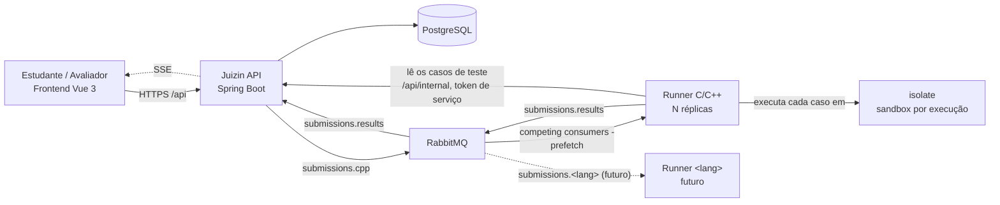

# Arquitetura do Sistema - Juizin API

O diagrama abaixo representa a arquitetura e o fluxo de dados do sistema entre o frontend, backend, fila de mensagens, runners e ambiente isolado (*sandbox*).

---

## 1. Diagrama de Arquitetura (Mermaid)

---

## 2. Descrição dos Componentes e Fluxos

| Componente Origem | Tipo de Conexão / Rota | Componente Destino | Descrição / Protocolo |
| :--- | :--- | :--- | :--- |
| **Estudante / Avaliador (Vue 3)** | `HTTPS /api` → | **Juizin API (Spring Boot)** | Envio de requisições do frontend para o backend. |
| **Juizin API (Spring Boot)** | `SSE` ⇢ | **Estudante / Avaliador (Vue 3)** | Resposta/atualizações em tempo real via Server-Sent Events. |
| **Juizin API (Spring Boot)** | Persistência → | **PostgreSQL** | Armazenamento de dados do sistema. |
| **Juizin API (Spring Boot)** | `submissions.cpp` → | **RabbitMQ** | Publicação de submissões na fila de mensagens. |
| **RabbitMQ** | `competing consumers - prefetch` → | **Runner C/C++ (N réplicas)** | Consumo dos jobs de submissão de código, distribuídos entre as réplicas. |
| **Runner C/C++ (N réplicas)** | `submissions.results` → | **RabbitMQ** | Envio dos resultados do julgamento de volta para a fila. |
| **RabbitMQ** | `submissions.results` → | **Juizin API (Spring Boot)** | Consumo dos resultados pela API, que atualiza a solução no banco e notifica o cliente. |
| **Runner C/C++ (N réplicas)** | `GET /api/internal/activities/{id}/test-cases` → | **Juizin API (Spring Boot)** | Leitura dos casos de teste com o token de serviço. O runner não acessa o PostgreSQL. |
| **RabbitMQ** | `submissions.<lang> (futuro)` ⇢ | **Runner `<lang>` (futuro)** | Suporte planejado para novos executores em outras linguagens. |
| **Runner C/C++ (N réplicas)** | `executa cada caso em` → | **isolate (sandbox por execução)** | Execução segura dos testes em ambiente isolado. |
