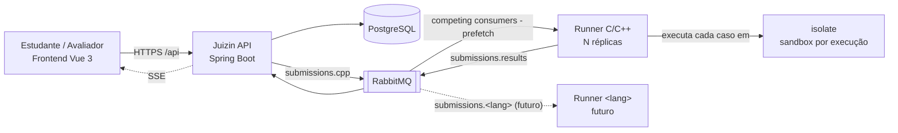
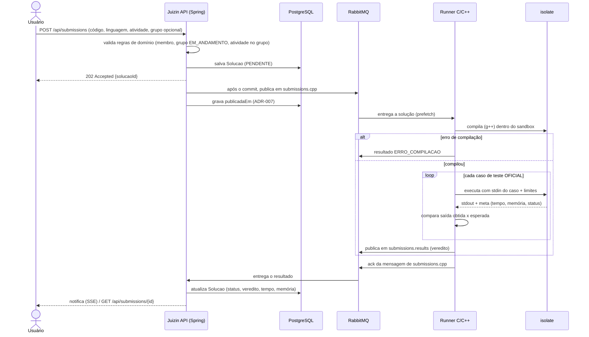
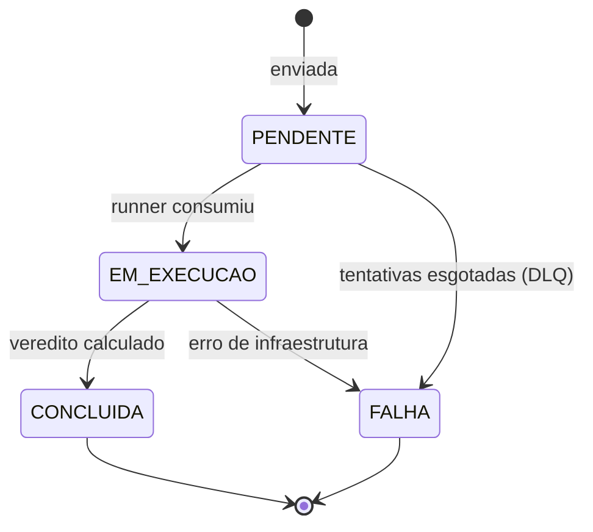
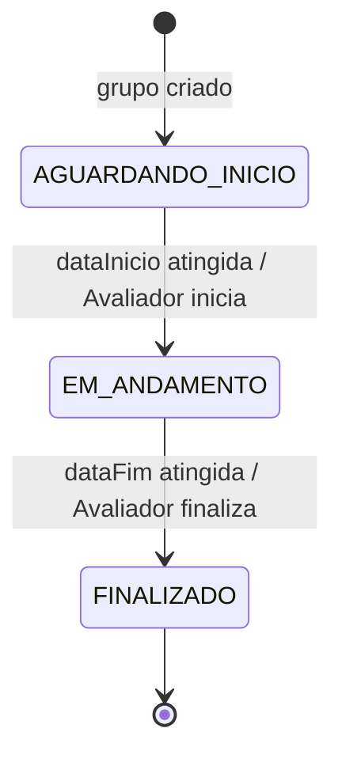
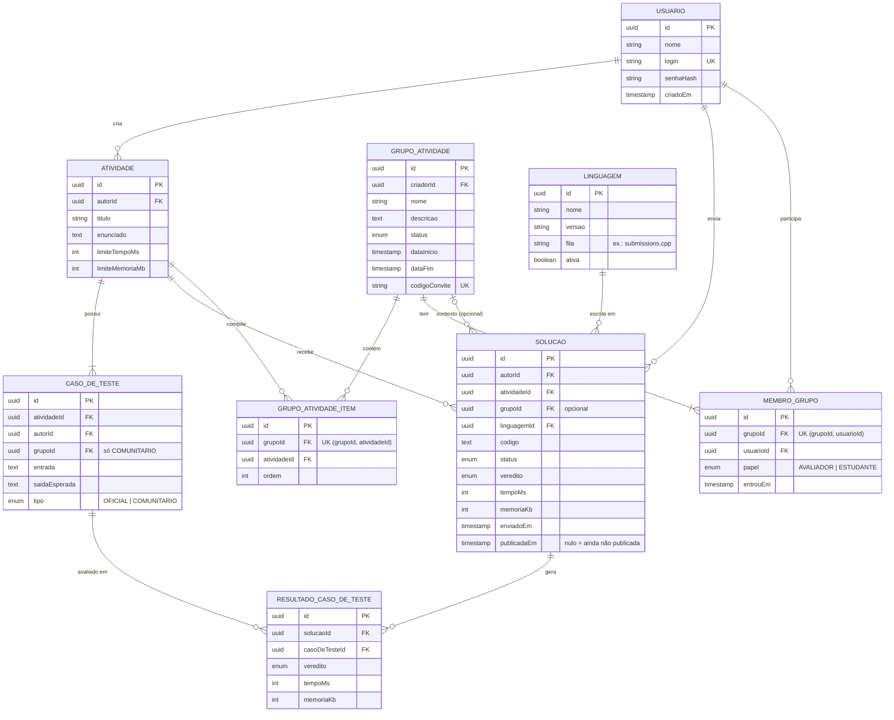

# 1. Visão geral

O **Juizin** é uma plataforma de correção de código fonte automatizada 

# 2. Personas e Atores (Quem usa)

Existe um único tipo de conta: o **Usuário** (login e senha). **Estudante** e **Avaliador** não são perfis globais, e sim **papéis dentro de cada Grupo de Atividade** (`MembroGrupo.papel`). O mesmo **Usuário** pode ser **Avaliador** em um grupo e **Estudante** em outro.

| Persona                       | Descrição                                                                                  | Ações                                                                                                                                                                                    |
|:------------------------------|:-------------------------------------------------------------------------------------------|:-----------------------------------------------------------------------------------------------------------------------------------------------------------------------------------------|
| **Visitante** (sem login)     | Quem acessa o Juizin sem entrar                                                            | lista as atividades e vê o enunciado e as linguagens; para enviar uma solução, precisa entrar ou criar uma conta                                                                        |
| **Usuário** (fora de grupo)   | Qualquer usuário autenticado                                                               | cria atividades e os casos de teste oficiais das próprias atividades, envia soluções avulsas para qualquer atividade, cria grupos de atividades, visualiza as próprias soluções         |
| **Estudante** (no grupo)      | Membro de um grupo, que entrou pelo link de convite                                        | envia soluções para as atividades do grupo, cria casos de teste comunitários (visíveis só para membros do grupo), compartilha o link de convite, visualiza as próprias soluções |
| **Avaliador** (no grupo)      | Criador do grupo ou membro promovido por outro **Avaliador**                               | tudo que o **Estudante** faz, mais: gerencia atividades e datas do grupo, inicia/finaliza o grupo, promove membros a **Avaliador**, visualiza e compara as soluções de todos os membros do grupo |

# 3. Visão Arquitetural de Alto Nível

## 3.1 Visão geral

A arquitetura do **Juizin** é **assíncrona e orientada a mensagens**. O **Usuário** envia uma solução para a API, que valida as regras de domínio (ver 5.4), persiste a **Solução** e a publica na fila da linguagem correspondente (RabbitMQ). Um **Runner** daquela linguagem consome a mensagem, compila e executa o código em um sandbox (**isolate**), compara a saída obtida com a saída esperada de cada caso de teste oficial e publica o veredito em uma fila de resultados. A API consome esse resultado, atualiza a **Solução** e notifica o cliente.

Neste primeiro momento **apenas o Runner C/C++ é implementado**. A arquitetura já prevê novas linguagens e mais réplicas (ver 3.5).

## 3.2 Diagrama de Containers (C4 nível 2)

## 3.3 Diagrama de Sequência: fluxo de envio de solução

> Os nomes técnicos de filas e endpoints (`submissions.*`, `/api/submissions`) são contratos técnicos e permanecem em inglês.

> **Runner simulado (desenvolvimento):** enquanto a integração com o RabbitMQ é TODO, o `RunnerSimulado` consome o `SolucaoEnviadaEvent` dentro da própria API e devolve um veredito fictício: `ACEITA` por padrão, ou o veredito indicado pela diretiva `juizin-mock: <VEREDITO>` no código. Ele passa a solução por `EM_EXECUCAO` antes do resultado e é desligado com `juizin.runner.mock.enabled=false`.

## 3.4 Responsabilidades por componente e tecnologia

| Componente    | Tecnologia                                                     | Responsável por                                                                                                                                                                                                                                                                                  | NÃO é responsável por                         |
|:--------------|:---------------------------------------------------------------|:-------------------------------------------------------------------------------------------------------------------------------------------------------------------------------------------------------------------------------------------------------------------------------------------------|:----------------------------------------------|
| Frontend      | Vue 3 + Pinia + PrimeVue 4 (`juizin/`)                         | Catálogo público de atividades; editor e envio da solução; exibir status e veredito; ouvir notificações via SSE (enquanto o SSE é TODO, consulta o status por polling)                                                                                                                           | Validar o resultado                           |
| Juizin API    | Spring Boot (Java 21)                                          | Autenticação; autorização por papel no grupo; validar a solução (linguagem suportada, tamanho do código, regras de grupo); persistir; publicar na fila da linguagem; consumir resultados; atualizar o status; notificar o cliente                                                                | Executar código do usuário                    |
| Banco         | PostgreSQL                                                     | Fonte da verdade: usuários, atividades, casos de teste, grupos e membros, soluções e vereditos                                                                                                                                                                                                   | Transportar jobs                              |
| Mensageria    | RabbitMQ                                                       | Desacoplar a API dos runners; servir de buffer em picos; rotear por linguagem (exchange direct, 1 fila por linguagem); distribuir a carga entre réplicas (competing consumers); retry e DLQ nativos; devolver resultados (`submissions.results`)                                                 | Executar ou isolar código; guardar estado final |
| Runner C/C++  | Container Docker (imagem com g++ + isolate) + processo worker  | Consumir `submissions.cpp`; preparar o box; chamar o isolate para compilar e executar; ler o meta-arquivo; **comparar a saída** (normalizando espaços e quebras de linha finais); montar o veredito; publicar o resultado; confirmar (ack) a mensagem; limpar o box                                  | Persistir no banco; falar com o cliente       |
| Sandbox       | **isolate**                                                    | Isolar **cada** compilação/execução: namespaces Linux (sem rede, PIDs e filesystem próprios), cgroups (limites de CPU, memória e nº de processos), limites de tempo (CPU e wall), tamanho máximo de arquivo, diretório de trabalho (box) descartável; relatar tempo, memória, exit code e sinal no meta-arquivo | Decidir o veredito; comparar a saída          |

## 3.5 Escalabilidade

A escalabilidade é desenhada para N linguagens, mas implementada inicialmente apenas para C/C++.

- **Horizontal por linguagem:** mais réplicas do `runner-cpp` consumindo a mesma fila `submissions.cpp` (competing consumers), **sem limite de partições**.
- **Vertical por réplica:** cada runner processa até N soluções em paralelo, usando `--box-id` distintos do isolate (um box por execução simultânea). O `prefetch` do consumidor é igual a N.
- **Novas linguagens:** nova imagem + fila `submissions.<lang>` ligada ao exchange `juizin.submissions`. A API só precisa conhecer o mapeamento linguagem → fila (entidade `Linguagem`, ver 5.1), sem alterar o código do fluxo.
- **Resultados:** uma única fila `submissions.results`, consumida pela API.
- **Caminho de escala:** um nó (MVP) → cluster de 3 nós com filas quorum e sharding das filas mais carregadas via consistent-hash exchange (regional) → brokers regionais com Federation/Shovel (nacional). O gargalo esperado é a CPU dos runners, não o broker. Detalhes e gatilhos para reavaliar o Kafka no [ADR-006](adr/006-rabbitmq-mensageria.md).

## 3.6 Riscos e restrições conhecidas

- O isolate exige que o container do runner rode **privilegiado / com acesso a cgroups v2** (ver [ADR-005](adr/005-runner-container-privilegiado.md)).
- **A compilação também roda no sandbox**: o g++ pode ser abusado (ex.: `#include "/dev/random"`, binários enormes).
- **O RabbitMQ é at-least-once** (a mensagem é reentregue se não houver ack): o processamento deve ser idempotente pelo `solucaoId`.
- **Dual write DB + RabbitMQ**: publicação após o commit + job de reconciliação ([ADR-007](adr/007-publicacao-apos-commit-reconciliacao.md)).
- **Sem replay**: depois do ack, a mensagem deixa de existir. O PostgreSQL é a fonte da verdade.
- Execuções longas não podem passar do `consumer_timeout` do RabbitMQ (padrão de 30 min).
- Medir tempo de **CPU** (não wall) e fixar CPU por box para evitar o efeito de vizinho barulhento.
- A mensagem leva o código e os IDs dos casos de teste; o runner busca e cacheia os casos.

## 3.7 Decisões em aberto

- Estados e vereditos da solução → seções 4.1 e 5.3.
- Modelo de domínio → seção 5.
- Decisões técnicas registradas como ADRs → seção 6 e [docs/adr](adr/README.md).
- Linguagem de implementação do worker do runner (ex.: Java/Spring AMQP ou um processo leve) → definir no spike.

# 4. Fluxos críticos de negócio

## 4.1 Envio e avaliação de solução

Fluxo técnico detalhado no diagrama 3.3. Regras aplicadas pela API antes de persistir:

- Solução **avulsa** (sem grupo): qualquer usuário autenticado, para qualquer atividade.
- Solução **no grupo**: o autor precisa ser membro, a atividade precisa fazer parte do grupo e o grupo precisa estar `EM_ANDAMENTO`.
- Apenas os casos de teste `OFICIAL` participam do veredito.

Ciclo de vida da **Solução**:

## 4.2 Ciclo de vida do Grupo de Atividade

As transições acontecem automaticamente por `dataInicio`/`dataFim` (job agendado) ou manualmente por um **Avaliador**. Não há volta de estado.

## 4.3 Gestão de membros

1. O **Usuário** cria o grupo: ele vira **Avaliador** e o `codigoConvite` é gerado (uma única vez).
2. Qualquer membro compartilha o link de convite, que aciona `POST /api/groups/join/{codigoConvite}`.
3. Um usuário autenticado acessa o link e entra como **Estudante**. Se já for membro, nada muda; se o grupo estiver `FINALIZADO`, a entrada é recusada.
4. Um **Avaliador** pode promover um membro a **Avaliador**.

# 5. Modelo de dados de domínio

## 5.1 Entidades

| Entidade                 | Descrição                                                  | Atributos principais                                                                                                  |
|:-------------------------|:-----------------------------------------------------------|:----------------------------------------------------------------------------------------------------------------------|
| **Usuario**              | Usuário da aplicação (login e senha)                       | id, nome, login, senhaHash, criadoEm                                                                                   |
| **Atividade**            | Enunciado do exercício; criada por qualquer usuário        | id, autor, titulo, enunciado, limiteTempoMs, limiteMemoriaMb                                                           |
| **CasoDeTeste**          | Entrada e saída esperada de uma atividade                  | id, atividade, autor, entrada, saidaEsperada, tipo (`OFICIAL` / `COMUNITARIO`), grupo (só para os comunitários)       |
| **Linguagem**            | Linguagem suportada e o roteamento para o runner (ver 3.5) | id, nome, versao, fila (ex.: `submissions.cpp`), ativa                                                                 |
| **Solucao**              | Código enviado por um usuário para uma atividade           | id, autor, atividade, grupo (opcional), linguagem, codigo, status, veredito, tempoMs, memoriaKb, enviadoEm, publicadaEm |
| **ResultadoCasoDeTeste** | Resultado de cada caso de teste oficial executado          | id, solucao, casoDeTeste, veredito, tempoMs, memoriaKb                                                                 |
| **GrupoAtividade**       | Compilado de atividades com ciclo de vida                  | id, criador, nome, descricao, status, dataInicio, dataFim, codigoConvite                                               |
| **GrupoAtividadeItem**   | Associação N:N entre grupo e atividade                     | grupo, atividade, ordem                                                                                                |
| **MembroGrupo**          | Participação de um usuário em um grupo                     | grupo, usuario, papel (`AVALIADOR` / `ESTUDANTE`), entrouEm                                                            |

> **Convite:** é um link único por grupo (`codigoConvite`), gerado uma única vez na criação do grupo. Acessar o link resulta na criação de um `MembroGrupo` com papel `ESTUDANTE`.

## 5.2 Diagrama ER

## 5.3 Enums

- `StatusGrupo`: `AGUARDANDO_INICIO`, `EM_ANDAMENTO`, `FINALIZADO`
- `PapelGrupo`: `AVALIADOR`, `ESTUDANTE`
- `StatusSolucao`: `PENDENTE`, `EM_EXECUCAO`, `CONCLUIDA`, `FALHA`
- `Veredito`: `ACEITA`, `RESPOSTA_ERRADA`, `TEMPO_EXCEDIDO`, `MEMORIA_EXCEDIDA`, `ERRO_EXECUCAO`, `ERRO_COMPILACAO`, `ERRO_INTERNO`
- `TipoCasoDeTeste`: `OFICIAL`, `COMUNITARIO`

## 5.4 Regras de domínio

- Qualquer usuário cria atividades e envia soluções para qualquer atividade, com ou sem grupo.
- Uma atividade pode fazer parte de vários grupos (N:N).
- Quem cria o grupo vira automaticamente `AVALIADOR`. Um grupo tem sempre pelo menos 1 `AVALIADOR`.
- Só o `AVALIADOR` promove membros a `AVALIADOR`, edita o grupo, adiciona ou remove atividades e inicia ou finaliza o grupo manualmente.
- Convite: qualquer membro pode compartilhar o link do grupo. Ao acessá-lo autenticado, o usuário entra como `ESTUDANTE`. Se já for membro, nada muda (operação idempotente). Não é possível entrar em grupo `FINALIZADO`.
- Uma solução com `grupo` só é aceita se o autor for membro, a atividade fizer parte do grupo e o grupo estiver `EM_ANDAMENTO`.
- Casos `OFICIAL` são criados pelo autor da atividade e **são os únicos usados no veredito**. Casos `COMUNITARIO` são criados por membros de um grupo e só ficam visíveis para os membros desse grupo.
- Visibilidade de soluções: o autor vê as próprias; o `AVALIADOR` vê todas as soluções do seu grupo.

# 6. Decisões técnicas e restrições de segurança

- Senhas armazenadas apenas como hash (BCrypt).
- Leitura pública: `GET /api/activities`, `GET /api/activities/{id}` e `GET /api/languages` não exigem login (catálogo para visitantes). Todo o resto exige JWT, inclusive os casos de teste.
- As autorizações por papel no grupo são verificadas no `service`, não só no frontend.
- O `codigoConvite` deve ser um token aleatório e não previsível (ex.: 128 bits, URL-safe). Como ele não é regenerado, um link vazado não pode ser revogado: **risco aceito por enquanto**.
- Decisões de arquitetura registradas como ADRs em [docs/adr](adr/README.md):
    - [ADR-001](adr/001-kafka-mensageria.md): Kafka como mensageria entre API e runners (Substituída pelo ADR-006)
    - [ADR-002](adr/002-isolate-sandbox.md): isolate como sandbox de cada execução (Aceita)
    - [ADR-003](adr/003-sse-notificacao-resultado.md): SSE para notificar o resultado ao cliente (Proposta)
    - [ADR-004](adr/004-transactional-outbox.md): Transactional Outbox para publicar soluções no Kafka (Substituída pelo ADR-007)
    - [ADR-005](adr/005-runner-container-privilegiado.md): runner em container privilegiado com cgroups v2 (Aceita)
    - [ADR-006](adr/006-rabbitmq-mensageria.md): RabbitMQ como mensageria entre API e runners (Aceita)
    - [ADR-007](adr/007-publicacao-apos-commit-reconciliacao.md): publicação após o commit com job de reconciliação (Aceita)
